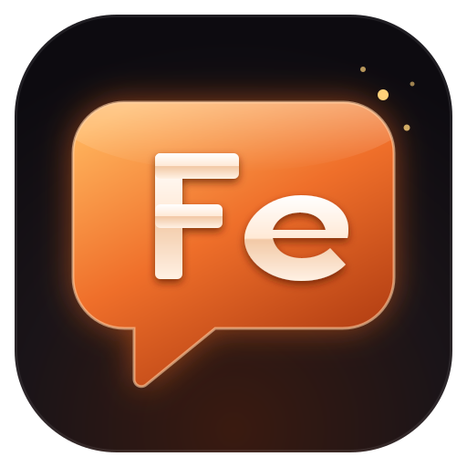

<p align="center"></p>

# Ferrochat

A lightweight Discord client for Windows, written in Rust.

It's a real native app, not a web browser in disguise like the official one, so
it uses far less memory: about 60–100 MB with the GPU renderer off.

> 🤖 Ferrochat was written by Claude, Anthropic's AI coding agent. A person
> decided what it should do and tested it.

> ⚠️ **Account risk:** Discord's rules forbid third-party clients on normal
> accounts, and accounts can be banned for it. Use a spare account, or a bot
> (bots are allowed).

## Download

1. Go to [Releases](https://github.com/shadysplayfab-jpg/FerroChat/releases)
   and download `ferrochat.exe`.
2. Double-click it. If Windows shows "Windows protected your PC", click
   **More info → Run anyway**. (The exe isn't code-signed.)

That's it. Nothing to install. Needs 64-bit Windows 10 or 11.

## How to log in

Ferrochat logs in with a **token**, a long code that acts like your password.

> 🔒 **Never share your token.** Anyone who has it can use your account. If it
> leaks, change your Discord password: the old token stops working.

### Option A: your own account (spare account recommended)

1. Open <https://discord.com/app> in Chrome, Edge or Firefox and log in.
2. Press **F12**. A panel opens.
3. Click the **Network** tab at the top of that panel.
4. In the panel's filter box, type `api`.
5. Click any channel in Discord, so lines appear in the panel.
6. Click one of the lines (for example `messages?limit=50`).
7. On the right, open **Headers** and scroll to **Request Headers**.
8. Find **Authorization**. Copy its value (a long code with two dots in it).
9. Open Ferrochat, paste it into the box, tick **Remember me**, and click
   **Log in**.

### Option B: a bot (allowed by Discord)

A bot is a separate account. It only sees servers you add it to, and has no
friends or DMs.

1. Open the [Developer Portal](https://discord.com/developers/applications)
   and click **New Application**. Name it.
2. Click **Bot** on the left.
3. Under **Privileged Gateway Intents**, turn on **Message Content Intent**.
   Click **Save**.
4. Click **Reset Token**, then **Copy**.
5. Click **OAuth2 → URL Generator** on the left. Tick `bot`, then tick
   **View Channels**, **Send Messages** and **Read Message History**.
6. Open the link at the bottom and pick your server.
7. In Ferrochat, type `Bot `, a space, then paste the token:
   `Bot MTIz...`. Click **Log in**.

### Staying logged in

- **Remember me** saves your token encrypted in Windows Credential Manager,
  never in a file. Next time Ferrochat logs you in by itself.
- **Settings → Log out** forgets it.
- **Settings → Add another account** lets you switch between accounts.

### If it doesn't work

| Message | Fix |
|---|---|
| `4004: Authentication failed` | Wrong or old token. Copy a fresh one. |
| `4014: Disallowed intent(s)` | Bot only: do step 3 of Option B. |
| Asks for a captcha | Do that step (joining a server, adding a friend) in the browser. |
| Stuck on "Connecting…" | Check your internet or firewall. |

## What it can do

- Servers, DMs, group DMs, friends, inbox
- Replies, edits, reactions, pins, search, threads, forums, polls, stickers
- Images, GIFs, pasting images with Ctrl+V, file uploads
- Voice channels, watching streams and sharing your screen
- Themes (9 built in, or your own `.css`), compact mode, tray icon

Heavy features can be switched off in **Settings → Performance** to save more
memory.

## Known limits

- Voice, video and screen share are new and not fully tested on live calls.
- Video attachments open in the browser.
- Windows only.

## Build it yourself

You need [Rust](https://rustup.rs) and Visual Studio's C++ build tools (with the
Windows SDK). Then:

```bash
cargo build --release
```

The exe lands in `target/release/ferrochat.exe`. If `link.exe` isn't found,
run the command from the "x64 Native Tools Command Prompt" that comes with
Visual Studio.

## License

[MIT](LICENSE)
