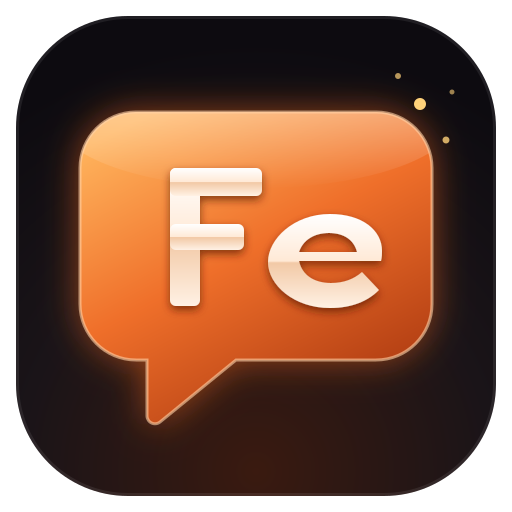

<p align="center"></p>

# Ferrochat

A native Discord client for Windows, built with Rust. It uses less memory than a web browser based client. With the GPU renderer turned off, it typically uses about 60–100 MB.

Ferrochat is developed with Codex, OpenAI's coding agent, under the direction and testing of the project maintainer.

> **Before you log in:** Discord may ban accounts for using third-party clients. Use a spare account. Discord bots are allowed.

## Download

1. Open [Ferrochat Releases](https://github.com/shadysplayfab-jpg/FerroChat/releases).
2. Download `ferrochat.exe` from the latest release. The current release is **v0.3.1**.
3. Open the file. If Windows shows a security warning, the app is unsigned. Click **More info → Run anyway** if you choose to continue.

Ferrochat needs 64-bit Windows 10 or 11. There is nothing to install.

### Check your download

Each release includes a SHA-256 checksum file. Open PowerShell in the folder where you downloaded Ferrochat and run:

```powershell
Get-FileHash .\ferrochat.exe -Algorithm SHA256
```

Compare the hash shown with the one in `ferrochat.exe.sha256` from the same release.

## Log in

### Recommended: email and password

1. Open Ferrochat and enter your Discord email or phone number.
2. Enter your password.
3. Select **Remember me** if you want Ferrochat to keep you signed in.
4. Select **Log in**.
5. If asked, enter your authenticator code or a backup code.

Your password is sent to Discord and is not saved by Ferrochat. If Discord asks for a captcha, solve it in the window that opens. SMS two-factor codes are not supported.

### Use a bot token

Discord permits bot accounts. A bot only sees servers where you add it. It has no friends list or DMs.

1. Create an application in the [Discord Developer Portal](https://discord.com/developers/applications).
2. Select **Bot** and enable **Message Content Intent** under **Privileged Gateway Intents**, then save.
3. Select **Reset Token**, then copy the new token.
4. Open **OAuth2 → URL Generator**. Select `bot`, then choose **View Channels**, **Send Messages**, and **Read Message History**.
5. Open the generated link and add the bot to your server.
6. In Ferrochat's token field, enter `Bot ` followed by your token, then select **Log in with token**.

### Use your own account's token

This method carries the same account risk described above. Use a spare account and never share the token. It works as a fallback if email login is blocked by a captcha.

1. Sign in to [Discord in your browser](https://discord.com/app).
2. Press **F12** and open the **Network** tab.
3. Type `api` in the network filter, then click a channel.
4. Select a request such as `messages?limit=50`.
5. In **Headers**, find **Request Headers → Authorization** and copy its value.
6. Paste the value into Ferrochat's **Token** field and select **Log in with token**.

A token grants access like a password. If it may have leaked, change your Discord password to invalidate it.

## Stay signed in

- **Remember me** saves your token encrypted in Windows Credential Manager.
- **Settings → Log out** removes the saved login.
- **Settings → Add another account** lets you switch accounts.

## Troubleshooting

| What you see | What to try |
|---|---|
| `4004: Authentication failed` | Check the token and copy a fresh one if needed. |
| `4014: Disallowed intent(s)` | For a bot, enable **Message Content Intent** in the Developer Portal. |
| Login asks for a captcha | Complete the captcha. If it keeps appearing, try the requested action in Discord's browser app. |
| Ferrochat stays on “Connecting…” | Check your internet connection and firewall. |

## Features

- Servers, direct and group messages, friends, and inbox
- Replies, edits, reactions, pins, search, threads, forums, polls, and stickers
- Images, GIFs, file uploads, and pasting images with Ctrl+V
- Voice channels, screen sharing, and watching streams
- Nine built-in themes, custom themes, compact mode, and a notification-area icon

Turn off features you do not need under **Settings → Performance** to save memory.

## Known limits

- Voice, video, and screen sharing have not been fully tested in live calls.
- Video attachments open in your browser.
- Ferrochat runs on Windows only.

## Build from source

Install [Rust](https://rustup.rs) and the C++ build tools from Visual Studio with the Windows SDK. Then run:

```powershell
cargo build --release
```

The executable is created at `target/release/ferrochat.exe`. If the build cannot find `link.exe`, use Visual Studio's **x64 Native Tools Command Prompt**.

## License

[MIT](LICENSE)